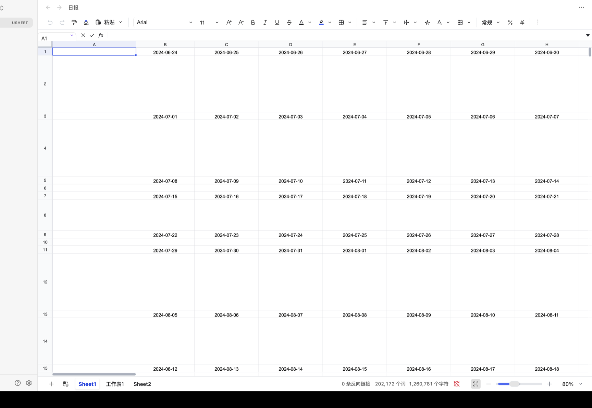
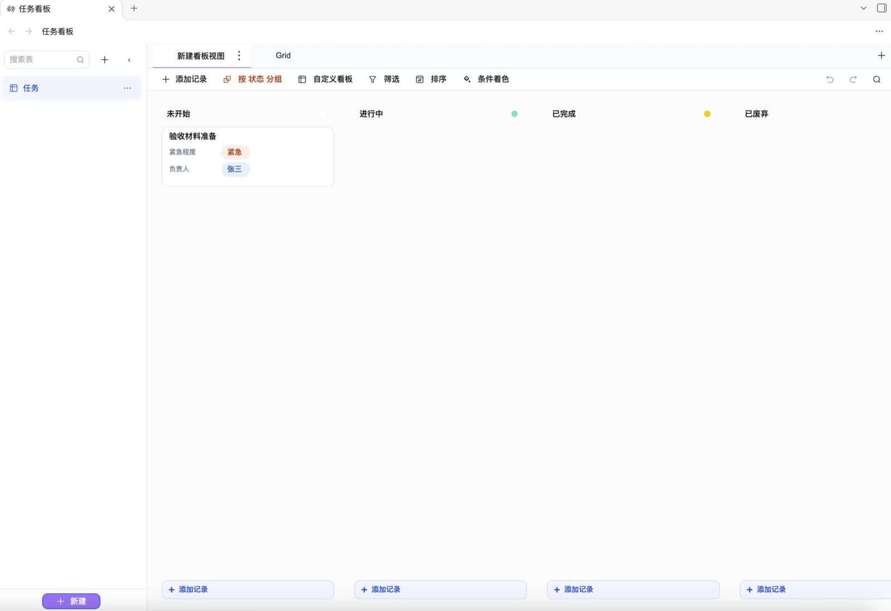

# Univer for Obsidian

简体中文 | [English](README.md)

支持 Univer 表格与关系表的 Obsidian 插件，基于 Univer **1.2.0**。

## 功能简介

- 在 Obsidian 中打开、编辑和保存 `.usheet` 表格与 `.ubase` 关系表。
- 单选字段可在记录编辑面板中直接输入新值并按回车，自动创建选项。
- 手动创建「完成时间」日期字段后，卡片移动到「已完成」时会按该字段的格式写入完成时间。
- 记录详情中的文本字段会随内容自动增高。
- 日期字段选择「记录创建时间」默认值后，会自动按记录创建时间回填。
- 仅表格界面：紧凑工具栏、公式栏、Sheet 标签和缩放控件。
- 保留单元格格式、公式、多工作表和行列尺寸。
- 记住每个文件的工作表与滚动位置，并跟随 Obsidian 的明暗主题和语言。

## Univer 依赖

| 包 | 版本 | 用途 |
| --- | --- | --- |
| `@univerjs/presets` | 1.2.0 | `createUniver`、语言包合并、`defaultTheme` |
| `@univerjs/preset-sheets-core` | 1.2.0 | `UniverSheetsCorePreset`、工具栏、公式栏、数字格式、表格命令 |
| `@univerjs/core` | 1.2.0 | 核心服务与类型（`ICommandService`、`IUndoRedoService`、`IWorkbookData`） |
| `@univerjs/sheets` | 1.2.0 | 工作簿 / 工作表模型与 facade 类型 |
| `react` / `react-dom` | 18.3.1 | Univer UI 必需的 peer 依赖 |
| `rxjs` | 7.8.2 | Univer 必需的 peer 依赖 |
| `@univerjs-pro/bases` | 1.2.0 | Univer Bases 关系表模型与命令 |
| `@univerjs-pro/bases-ui` | 1.2.0 | Bases UI 与渲染集成 |
| `@univerjs-pro/license` | 1.2.0 | Univer Pro 授权注册 |
| `@univerjs-pro/engine-formula` | 1.2.0 | Bases 所需的 Pro 公式引擎 |

所有 `@univerjs/*` 包固定在同一版本（`1.2.0`）。

只注册 sheets-core preset 和 Bases 插件；不包含文档、Excel 导入导出和协作模块。

> **Univer Bases 属于 Univer Pro。** 当前构建包含 `@univerjs-pro` 商业包，请保持仓库私有；没有商业授权时不要对外分发。可在插件设置中填入 license 以退出评估模式。
